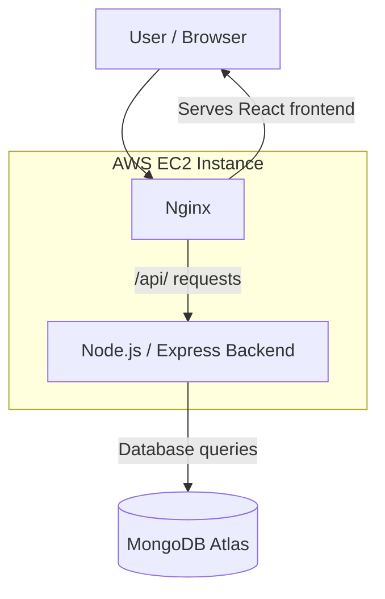
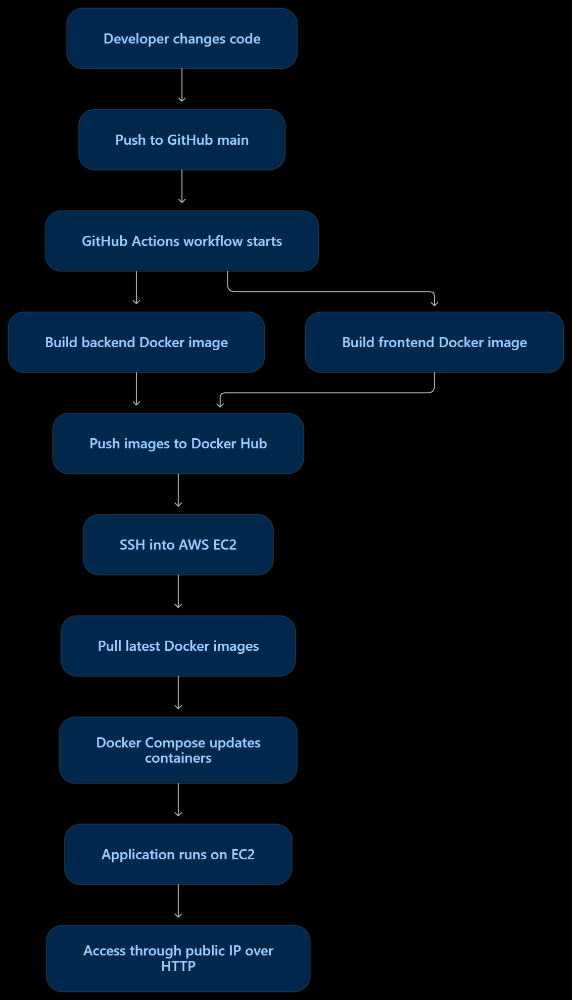
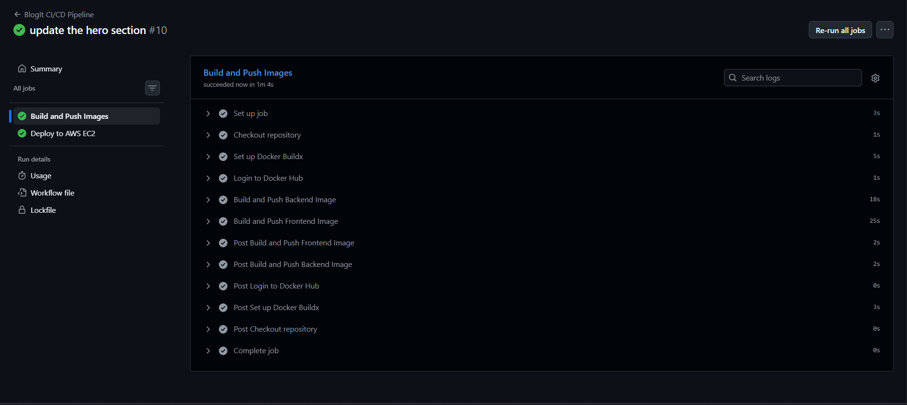
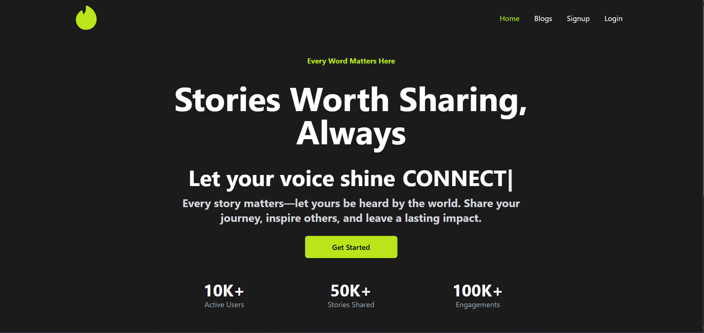
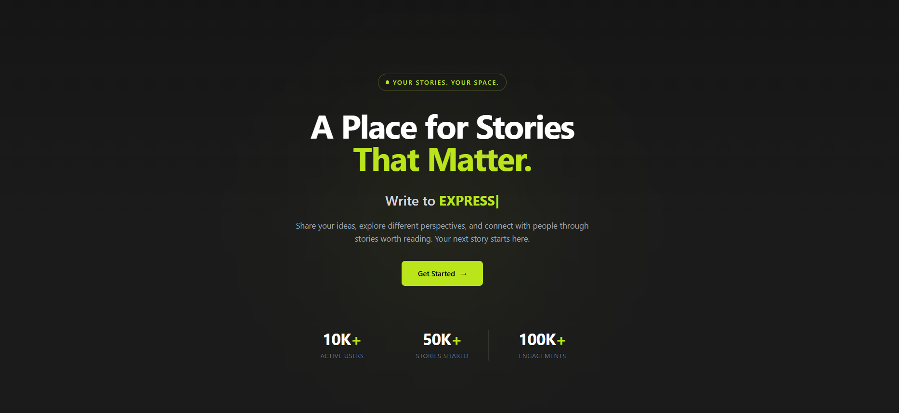

# Blogit - Dockerized MERN Application & Automated CI/CD

A containerized MERN stack application deployed on AWS EC2 with an automated CI/CD pipeline using GitHub Actions and Docker Hub.

<p align="center">
  <strong>Docker · GitHub Actions · Docker Hub · AWS EC2 · Nginx</strong>
</p>

## Overview

This project demonstrates the containerization and cloud deployment of an existing MERN stack blogging application.

The frontend and backend are packaged into separate Docker containers and managed using Docker Compose. A GitHub Actions workflow automates the build, publishing, and deployment process.

Whenever changes are pushed to the `main` branch, the pipeline builds updated Docker images, publishes them to Docker Hub, connects to the AWS EC2 instance over SSH, and deploys the updated containers.

## Architecture

The application uses a two-container architecture. Nginx serves the React frontend and acts as a reverse proxy for backend API requests.

## Application Architecture



## CI/CD Architecture

<p align="center">
  
</p>


## Technology Stack

| Category | Technologies |
|---|---|
| Frontend | React |
| Backend | Node.js, Express.js |
| Database | MongoDB Atlas |
| Containerization | Docker |
| Container Management | Docker Compose |
| Web Server / Reverse Proxy | Nginx |
| CI/CD | GitHub Actions |
| Container Registry | Docker Hub |
| Cloud Infrastructure | AWS EC2 |
| Version Control | Git, GitHub |

## Project Structure

```text
blogit-devops/
├── .github/
│   └── workflows/
│       └── deploy.yml
├── backend/
│   └── Dockerfile
├── frontend/
│   ├── Dockerfile
│   └── nginx.conf
├── docs/
│   └── screenshots/
│       ├── cicd-architecture.png
│       ├── github-actions-success.png
│       ├── application-before.png
│       ├── application-after.png
│       └── live-application-ec2.png
├── docker-compose.yml
├── docker-compose-prod.yml
└── README.md
```

## Docker Implementation

The application is divided into two independent Docker services.

### 1. Backend Container

The backend Dockerfile defines the Node.js runtime environment, installs the required dependencies, and configures the Express application to run inside a container.

The backend connects to MongoDB Atlas using environment-based configuration.

### 2. Frontend Container

The frontend Dockerfile builds the React application and serves its production build using Nginx.

### 3. Nginx Reverse Proxy

Nginx serves the frontend and forwards API requests to the backend service.

Requests under `/api/` are forwarded to:

```text
http://backend:8000
```

This allows the frontend to communicate with the backend through Docker's internal network without exposing the backend port publicly.

### 4. Docker Compose

The production configuration, `docker-compose-prod.yml`, defines both services and their runtime settings.

It manages:

- Frontend and backend containers.
- Internal service communication.
- Environment file configuration.
- Port mapping.
- Container restart policies.
- Service dependencies.

The frontend is exposed on port `80`, while the backend remains accessible internally through the Docker network.

## CI/CD Pipeline – GitHub Actions

A GitHub Actions workflow automates the image build, publishing, and deployment process.

The workflow runs on pushes to the `main` branch and also supports manual execution through `workflow_dispatch`.

### Pipeline Stages

**1. Build Docker Images**

GitHub Actions builds separate Docker images for the frontend and backend.

**2. Publish Images to Docker Hub**

The built images are published to Docker Hub using two tags:

- `latest` – identifies the latest published image.
- Git commit SHA – identifies a specific version of the image.

**3. Connect to AWS EC2**

The deployment job connects to the EC2 instance using SSH authentication.

**4. Pull and Deploy Updated Images**

The deployment script executes:

```bash
docker compose -f docker-compose-prod.yml pull
docker compose -f docker-compose-prod.yml up -d --remove-orphans
```

The first command retrieves the latest images from Docker Hub. The second updates the running services using the new images.

**5. Verify Running Services**

The workflow checks the deployed containers using:

```bash
docker compose -f docker-compose-prod.yml ps
```

### Deployment Workflow

1. Push code changes to GitHub.
2. GitHub Actions starts the workflow.
3. Frontend and backend Docker images are built.
4. Images are published to Docker Hub.
5. The deployment job connects to AWS EC2.
6. Updated images are pulled and deployed.
7. The application becomes available with the latest changes.

## AWS EC2 Deployment

The application is hosted on an AWS EC2 instance running Docker and Docker Compose.

The EC2 instance acts as the deployment environment for the frontend and backend containers.

### Deployment Configuration

| Component | Configuration |
|---|---|
| Cloud Provider | AWS |
| Compute Service | EC2 |
| Container Runtime | Docker |
| Service Management | Docker Compose |
| Frontend Access | HTTP port 80 |
| Backend Access | Internal Docker network |
| Database | MongoDB Atlas |
| Web Server | Nginx |

### Network Configuration

- Port `80` is used to access the application over HTTP.
- Port `22` is used for SSH access.
- The backend runs internally and is not directly exposed to the public internet.
- Nginx forwards API requests to the backend container.

## Implementation Screenshots

### 1. Successful GitHub Actions Pipeline

The workflow successfully builds the frontend and backend images, publishes them to Docker Hub, and deploys the application to AWS EC2.

<p align="center">
  
</p>

### 2. Application Before and After Changes

A comparison of the BlogIt application before and after the changes.

<table>
  <tr>
    <th align="center">Before Changes</th>
    <th align="center">After Changes</th>
  </tr>
  <tr>
    <td align="center">
      
    </td>
    <td align="center">
      
    </td>
  </tr>
</table>

### 3. Live Application on AWS EC2

The updated BlogIt application is deployed and accessible through the EC2 public IP.

**Live Application:** [http://16.171.235.248](http://16.171.235.248)

<p align="center">
  
</p>

## Security & Configuration

Sensitive configuration values are managed through environment variables rather than being hardcoded into the application or workflow.

GitHub Actions uses repository secrets for Docker Hub access and deployment authentication. The backend environment file is maintained separately on the EC2 instance.

**Note:** The current deployment uses HTTP through the EC2 public IP. HTTPS and custom domain configuration are outside the scope of this implementation.

## Project Deliverables

| Requirement | Implementation |
|---|---|
| Dockerize an existing MERN application | Separate frontend and backend Docker containers |
| Set up CI/CD | GitHub Actions workflow |
| Publish container images | Docker Hub |
| Deploy to cloud infrastructure | AWS EC2 |
| Automate deployment | SSH-based deployment using Docker Compose |
| Provide deployed application | Public EC2 application URL |

## Author

**Syeda Arifa Batool**

Software Engineer focused on building practical applications across software development, AI/ML, and full-stack technologies.

- **Portfolio:** [arifa-batool-portfolio.vercel.app](https://arifa-batool-portfolio.vercel.app)
- **LinkedIn:** [Syeda Arifa Batool](https://www.linkedin.com/in/arifa-batool/)
- **GitHub:** [batoolarifa](https://github.com/batoolarifa)
- **Email:** [thearifabatool@gmail.com](mailto:thearifabatool@gmail.com)
